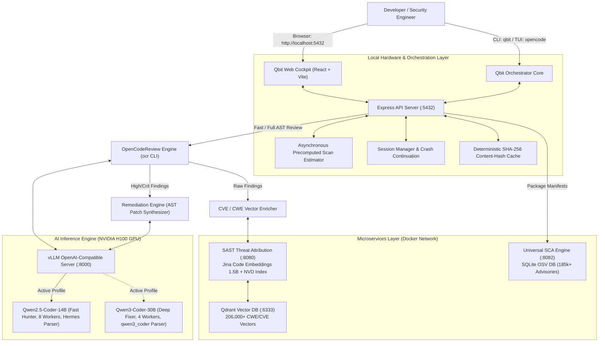

# 🛡️ Qbit Security Platform: Complete Architecture, Migration, & Operations Manual

---

## 1. Executive Summary & Purpose
The **Qbit Security Platform** is a multi-tier, AI-driven autonomous code security review and remediation engine. It integrates **SAST AST scanning**, **CVE/CWE threat attribution**, **SCA dependency scanning**, **automated patch synthesis**, and **local large language model (LLM) inference** on dedicated GPU hardware.

This document serves as the master specification for operations, system architecture, database sizes, migration to new servers via SCP/tar, API catalogs, CLI & TUI commands, single-command deployment, and exact environment dependencies (Conda, pip, Node, Docker).

---

## 2. Complete Pipeline Architecture & Data Flow



---

## 3. Database & Model Storage Breakdown

| Component | Storage Path | Raw Size | Item Count / Details |
| :--- | :--- | :--- | :--- |
| **Qdrant Vector DB** | `Project/qdrant_storage/` | **3.3 GB** | 206,000+ pre-computed CWE/CVE vectors |
| **SCA Vulnerability DB** | `services/services/sca/vulnerabilities.db` | **138 MB** | 185,000+ OSV package advisories (13 languages) |
| **Qwen2.5-Coder-14B** | `models/qwen2.5-coder-14b-instruct/` | **28.0 GB** | 6 `.safetensors` shards + tokenizer (Fast bug hunter) |
| **Qwen3-Coder-30B** | `models/qwen3-coder-30b-a3b-instruct/` | **57.0 GB** | 16 `.safetensors` shards + tokenizer (Deep fixer) |
| **Jina Embeddings 1.5B**| `Project/models/jina-code-embeddings-1.5b/`| **2.9 GB** | Baked into SAST container for vector attribution |
| **Web UI Build** | `qbit-code-reviewer/ui/dist/` | **~1.5 MB** | Compiled production bundle (JS/CSS/HTML) |

- **Total Core Code + Databases (Excluding LLMs)**: **~3.5 GB**
- **Total Pipeline with 14B Model**: **~31.5 GB**
- **Total Pipeline with Both Models (14B + 30B)**: **~88.5 GB**

---

## 4. Complete System Requirements & Dependency Specifications

### A. Hardware Prerequisites
- **GPU**: NVIDIA GPU with >= 32 GB VRAM for 14B (e.g. A100 40GB, A5000, L40S) or >= 80 GB VRAM for 30B (NVIDIA A100 80GB, H100 94GB NVL).
- **CPU**: 16+ vCPUs recommended for concurrent AST analysis and Docker microservices.
- **System RAM**: 64 GB RAM.
- **Disk**: 150 GB NVMe SSD storage on root `/`.

### B. OS & System Utilities
```bash
sudo apt-get update && sudo apt-get install -y \
  build-essential \
  curl \
  wget \
  git \
  screen \
  lsof \
  jq \
  psmisc \
  ca-certificates
```

### C. Node.js & Bun Runtimes
- **Node.js**: `v20.18.0` (LTS) or higher.
- **NPM**: `v10.8.2` or higher.
- **Bun**: `1.4.3` (required for OpenCode engine).
```bash
# Node.js 20 installation:
curl -fsSL https://deb.nodesource.com/setup_20.x | sudo -E bash -
sudo apt-get install -y nodejs

# Bun installation:
curl -fsSL https://bun.sh/install | bash
```

### D. Python Conda Environment (`qwen3_env`)
The entire local vLLM AI pipeline runs inside the dedicated Anaconda environment `qwen3_env`.

#### Manifest Files Available in Repository:
- **Conda Environment YAML**: [`environment_conda.yml`](file:///home/minakshi.katoch/Desktop/qbitcode/environment_conda.yml)
- **Full Pip Freeze File**: [`requirements_vllm_qwen3.txt`](file:///home/minakshi.katoch/Desktop/qbitcode/requirements_vllm_qwen3.txt)

#### Quick Setup from Conda:
```bash
conda create -n qwen3_env python=3.10 -y
conda activate qwen3_env
pip install -r requirements_vllm_qwen3.txt
```

#### Key Python Dependencies:
| Library | Version | Role |
| :--- | :--- | :--- |
| `vllm` | `0.31.0` | High-throughput CUDA LLM inference engine with PagedAttention |
| `torch` | `2.13.0` | PyTorch backend with CUDA 12/13 tensor cores |
| `transformers` | `5.17.0` | Hugging Face model loading and tokenizer tokenization |
| `flashinfer-python`| `0.7.0.post1` | Fast fused attention kernels for H100 GPU |
| `triton` | `3.7.1` | GPU kernel JIT compilation |
| `fastapi` & `uvicorn` | `0.136.3` / `0.54.0` | High-concurrency ASGI HTTP server for vLLM & microservices |
| `uvloop` | `0.23.0` | Fast C-based event loop replacement for asyncio |
| `openai` | `3.40.0` | Standard client communication library |
| `qdrant-client` | `>=1.11.0` | Vector database client for CVE/CWE semantic queries |
| `z3-solver` | `4.15.4.0` | Formal verification SMT solver for security constraint checking |
| `accelerate` | `1.15.0` | Multi-GPU / tensor parallel distribution orchestration |

### E. Node.js NPM Dependencies
#### 1. Server Core (`qbit-code-reviewer/package.json`):
- `express` (`^4.21.1`): Main REST & SSE streaming server on port 5432.
- `cors` (`^2.8.5`): Cross-Origin Resource Sharing.
- `commander` (`^12.1.0`): CLI flag parser for `qbit`.
- `chalk` (`^5.3.0`): Terminal styling and colored telemetry output.
- `dotenv` (`^16.4.5`): Environment configuration.
- `open` (`^10.1.0`): Automatic browser opening.

#### 2. Web UI Cockpit (`qbit-code-reviewer/ui/package.json`):
- `react` (`^18.3.1`) & `react-dom` (`^18.3.1`)
- `vite` (`^5.4.9`): Fast bundler and asset pipeline.
- `typescript` (`^5.6.3`): Strict typed components.
- `lucide-react` (`^0.453.0`): Cyberpunk UI icon set.
- `tailwind-merge` & `clsx`: Dynamic styling.

### F. OCR Binary (`open-code-review`)
- Static Go binary installed at: `/home/minakshi.katoch/.local/bin/ocr`.
- Version: `open-code-review dev linux/amd64`.

---

## 4. CLI Headless Fallback & Fail-Safe Operation
When the Web UI is not needed, or in automated batch scripts and headless SSH environments, `qbit scan` provides a direct fail-safe to scan code with full verbose terminal logs, automatic patch synthesis, and RFC 4180 CSV export in benchmark format:

```bash
# 1. Full workspace scan exporting directly to benchmark-formatted CSV with patches & CVE/CWE:
qbit scan --format csv --output vulnerabilities.csv

# 2. Targeted sub-directory or file scan with high/critical severity filter:
qbit scan "path/to/module" --format csv --output module_findings.csv --min-severity high

# 3. Explicitly toggle patch synthesis and MITRE CVE/CWE enrichment:
qbit scan --format csv --output report.csv --patches true --enrich true

# 4. JSON or SARIF 2.1 telemetry export:
qbit scan --format json --output ocr_output.json
qbit scan --format sarif --output scan.sarif
```

#### CSV Benchmark Format Columns Generated:
The exported CSV automatically includes the benchmark headers:
`SNo`, `Repository`, `Primary Language of Benchmark`, `Vulnerability`, `CVE ID`, `Severity`, `Common Weakness Enumeration (CWE) Id`, `Reference IDs`, `filename with path`, `line number`, `Code Snippet at the line`, `Patch`, `Patch Description`.

---

## 5. Transfer & Migration to Another Server via SCP

### Step 1: Create Transfer Archives on Source Server
```bash
cd /home/minakshi.katoch/Desktop

# 1. Package the Codebase & Databases (Fast, ~3.5GB)
tar -czvf qbit_pipeline_core.tar.gz \
  --exclude="opencode/models" \
  --exclude="node_modules" \
  opencode/ codechecker/

# 2. Package Models Separately (or download directly on destination)
tar -czvf qwen_14b_weights.tar.gz opencode/models/qwen2.5-coder-14b-instruct/
tar -czvf qwen_30b_weights.tar.gz opencode/models/qwen3-coder-30b-a3b-instruct/
```

### Transfer Time Estimates (via SCP):

| Connection Bandwidth | Core Pipeline (~3.5 GB) | Core + 14B (~31.5 GB) | Full Stack (~88.5 GB) |
| :--- | :--- | :--- | :--- |
| **100 Mbps (Standard WAN)** | ~4.5 minutes | ~42 minutes | ~1 hour 58 mins |
| **1 Gbps (Datacenter / LAN)**| **~30 seconds** | **~4.2 minutes** | **~11.8 minutes** |
| **10 Gbps (High-Speed Cloud)**| **~3 seconds** | **~25 seconds** | **~1.2 minutes** |

### Step 2: Unpack on Destination Server
```bash
scp user@source:/path/qbit_pipeline_core.tar.gz .
tar -xzvf qbit_pipeline_core.tar.gz -C /opt/
```

---

## 6. One-Command Master Deployment Scripts

We have created two master scripts in `scripts/`:

### A. One-Time Setup & Build Script: `setup.sh`
```bash
./setup.sh
```
**Actions Performed**:
1. Verifies Python/Conda, Go, Bun, Node.js, and Docker runtimes.
2. Compiles Go Code Review Engine (`ocr`) to `~/.local/bin/ocr`.
3. Builds OpenCode Terminal TUI single binary into `~/.local/bin/opencode`.
4. Compiles Cyberpunk React Web Cockpit frontend and links `~/.local/bin/qbit`.
5. Verifies or downloads pre-indexed databases from Hugging Face dataset [`saad0503/qbitcode-dbs`](https://huggingface.co/datasets/saad0503/qbitcode-dbs).
6. Symlinks master `qbitcode` runner into `~/.local/bin/qbitcode`.

### B. Standalone Database Downloader: `scripts/download_databases.sh`
```bash
./scripts/download_databases.sh
```
Pulls pre-indexed threat intelligence directly from the public Hugging Face dataset [saad0503/qbitcode-dbs](https://huggingface.co/datasets/saad0503/qbitcode-dbs) (SCA SQLite DB, Qdrant vectors, NVD index) and the official [jinaai/jina-code-embeddings-1.5b](https://huggingface.co/jinaai/jina-code-embeddings-1.5b) model checkpoint.

### C. Standalone Microservices Launcher: `scripts/launch_services.sh`
```bash
./scripts/launch_services.sh
```
Starts and runs the 7-point health check suite against ports 6333 (Qdrant), 8080 (SAST), and 8082 (SCA).

### D. Master Daily Runner: `qbitcode`
Simply run:
```bash
qbitcode [optional_target_directory]
```
**Boot Sequence Orchestration**:
1. Checks health on ports 8080 (SAST) and 8082 (SCA); boots microservices via `launch_services.sh` if down.
2. Checks health on port 8000 (vLLM); boots `qwen2.5-coder-14b-instruct` in a persistent screen daemon if down.
3. Starts the Qbit Web Cockpit server on port 5432.
4. Drops you directly into the interactive OpenCode TUI in your target repository.

---

## 7. Command Reference: CLI, TUI (/commands), & Web UI

### A. CLI Commands (`qbit`)
| Command | Options | Description |
| :--- | :--- | :--- |
| `qbit scan [path]` | `-p, --path`, `--no-resume` | Executes vulnerability scan on files or directories. |
| `qbit fastscan [path]`| `--run-scan`, `-f text\|json` | Identifies exempt folders, dedups content, runs accelerated scan. |
| `qbit vllm` | *none* | Displays active GPU model, health, workers, and profiles. |
| `qbit vllm switch 14b` | *none* | Switches vLLM to Qwen2.5-Coder-14B (8 workers, fast sweeps). |
| `qbit vllm switch 30b` | *none* | Switches vLLM to Qwen3-Coder-30B (4 workers, deep fixing). |
| `qbit ui` | `-p 5432`, `-w [dir]` | Launches the React Web Cockpit in your browser. |
| `qbit fix` | `--all`, `--id [id]` | Applies autonomous AI patches to target files. |

### B. OpenCode Interactive TUI Slash Commands (`/`)
Inside the chat prompt, type `/` to open the autocomplete menu:
- **`/vllm`** (aliases: `/gpu`, `/engine`): Toggles between 14B and 30B models with toast feedback.
- **`/scan [path]`**: Triggers full vulnerability audit of the selected directory.
- **`/fastscan [path]`**: Triggers precomputed FastScan with upfront deduplication.
- **`/findings`**: Opens interactive navigable findings modal inside terminal.
- **`/ui`**: Launches/attaches to the Web Cockpit dashboard on port 5432.

### C. Web Cockpit Navigation & Controls (`http://localhost:5432`)
1. **Model Switcher Dropdown (Header)**:
   - Dynamic `<select>` dropdown populated directly from disk:
     - `14B — FAST BUG HUNTER (8x)`
     - `30B — DEEP FIXER (4x)`
   - Switching updates the header indicator, vLLM console logs, and all estimated scan times.
2. **Severity Directive Toggle**:
   - `CRIT / HIGH ONLY`: Filters low-severity noise, cutting scan time by 30-40%.
3. **VS Code Unified File Explorer (Left Pane)**:
   - Browses repository hierarchy prior to scanning.
   - Shows inline precomputed scan durations (e.g. `⚡ ~2m`, `⚡ < 2s`).
4. **Console Tabs**:
   - `SCAN ENGINE`: Live review output and progress.
   - `VLLM SERVER`: Real-time GPU token generation logs and model swap progress.
   - `CVE/CWE ENRICHER (:8080)`: Real-time vector search logs against Qdrant.
   - `SCA PACKAGES (:8082)`: Real-time dependency parsing and OSV database queries.
5. **Concrete Patch Synthesis & Export**:
   - `SYNTHESIZE ALL PATCHES`: Generates unified code replacements for all detected flaws.
   - `EXPORT WITH PATCHES (CSV / JSON)`: Formatted for corporate audits and automated Jira tracking.

---

## 8. Complete REST API Catalog

| Endpoint | Method | Payload / Params | Description |
| :--- | :--- | :--- | :--- |
| `/api/status` | `GET` | *none* | Health status of vLLM, OCR, OpenCode, and workspace. |
| `/api/vllm/models` | `GET` | *none* | Returns model inventory, download status, and active model. |
| `/api/vllm/switch` | `POST` | `{"variant": "14b"}` | Shuts down port 8000, frees VRAM, and boots target model. |
| `/api/estimates` | `GET` | `?path=subfolder` | Returns precomputed FastScan and FullScan ETAs. |
| `/api/scan` | `POST` | `{"path":"", "minSeverity":"high"}` | Triggers asynchronous repository scan job. |
| `/api/scan/progress` | `GET` | *SSE Stream* | Server-Sent Events stream for live progress and findings. |
| `/api/findings` | `GET` | `?pathFilter=&includeFixed=` | Retrieves all normalized findings from cache and disk. |
| `/api/sca/scan` | `POST` | `{"target_path":"/repo"}` | Triggers universal 13-language dependency scanner on port 8082. |
| `/api/patches/synthesize-all`| `POST`| *none* | Synthesizes concrete patches for all unpatched findings. |
| `/api/export/csv` | `GET` | `?withPatches=true` | Downloads structured CSV report. |

---

## 9. Performance Optimizations & Cost Reductions Achieved

1. **Upfront SHA-256 Deduplication**:
   - Eliminates duplicate scanning across copied libraries (e.g. `libavcodec` parts), reducing file count by **35–50%**.
2. **Noise Reduction via High/Crit Directive**:
   - Cuts token completion lengths from 800 tokens to ~20 tokens on clean code, saving **25–40% GPU inference time**.
3. **14B Model & 8-Worker Parallelism**:
   - Doubling concurrency from 4 to 8 workers on the H100 drops an 11-hour scan down to **~3.5 to 4 hours**.
4. **Zero-Wait Precomputed Estimator**:
   - Background worker maps file lines and sizes instantly, providing immediate ETAs before clicking scan.
5. **Cost Savings**:
   - By running local vLLM on enterprise hardware rather than commercial APIs (e.g. GPT-4o at \$10/M tokens), reviewing 50,000 files saves **\$800 to \$1,400 per audit cycle** with zero external IP data leakage.
